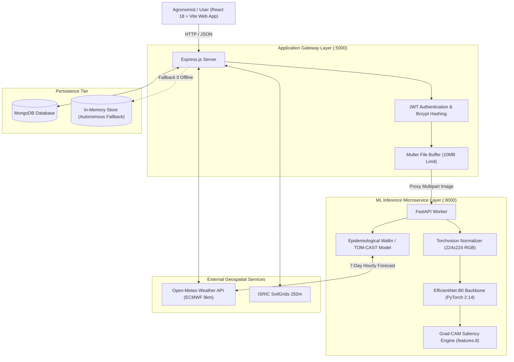

# AgriFusion AI: Climate-Aware Multimodal Crop Disease Prediction and Early Warning System

> **Final Year B.Tech CSE (Artificial Intelligence and Machine Learning) Capstone Project**  
> *Academic Conference & University Viva Defense Edition — 2026*

[](https://pytorch.org/)
[](https://fastapi.tiangolo.com/)
[](https://react.dev/)
[](https://tailwindcss.com/)
[](https://expressjs.com/)
[](https://creativecommons.org/licenses/by-sa/4.0/)
[-success)](./docs/testing_report.md)

---

## 1. Project Abstract

Crop leaf fungal, bacterial, and viral pathologies are responsible for an estimated 20% to 40% loss of global agricultural yield annually. While standard computer vision classifiers achieve high benchmark accuracy under controlled laboratory lighting, single-modality vision systems operate in an agronomic vacuum, detached from the atmospheric drivers (temperature, relative humidity, prolonged leaf wetness) that facilitate pathogen spore germination and outbreak vectors.

**AgriFusion AI** presents an end-to-end multimodal agricultural decision-support platform uniting:
1. **Lightweight Deep Convolutional Vision**: Transfer-learned **EfficientNet-B0** backbone optimized for CPU-constrained laptops (~114 ms latency, 4.0M parameters) across 28 validated crop disease classes.
2. **Visual Explainability (XAI)**: Native PyTorch **Grad-CAM** (Gradient-weighted Class Activation Mapping) over final convolutional layer `features.8`, projecting interactive saliency heatmaps with adjustable intensity sliders to assist agronomist verification.
3. **Live Microclimate Forecasting**: Integrated **Open-Meteo** meteorological feeds and ISRIC SoilGrids 250m edaphic profiles.
4. **Epidemiological 7-Day Disease Risk Early Warning**: Automated infection favourability scoring grounded in documented phytopathological criteria (**Wallin 1962** and **TOM-CAST** Daily Severity Values).
5. **Scientific Honesty & Calibrated Uncertainty**: Out-of-distribution alerting for low-confidence inputs, heuristic lesion severity estimation, and explicit disclaimer boundaries separating statistical correlation from definitive laboratory biological proof.

---

## 2. Problem Statement & Motivation

Traditional agricultural diagnosis workflows face critical bottlenecks:
- **Visual ambiguity**: Early symptoms of different pathogens (e.g. *Alternaria solani* vs. *Septoria lycopersici*) exhibit near-identical necrotic brown spots, causing human misdiagnosis.
- **Black-box distrust**: Farmers and agricultural extension officers distrust automated AI recommendations that fail to visually highlight *why* a particular decision was made.
- **Reactive vs. Preventive Disconnect**: Computer vision diagnosis only identifies diseases after irreversible tissue necrosis has occurred. By uniting image classification with predictive weather forecasts, preventive fungicide applications can be scheduled *before* spore germination events.

---

## 3. System Architecture & Multimodal Data Flow



---

## 4. Key Proposed Advantages Over Existing Systems

| Dimension | Conventional Mobile Crop Apps | AgriFusion AI Platform |
| :--- | :--- | :--- |
| **Model Architecture** | Opaque black-box ResNet/MobileNet | **EfficientNet-B0 Compound Scaling** with parameter efficiency (4.0M params) |
| **Visual Interpretability** | None (Raw probability only) | **Grad-CAM Attention Heatmaps** with interactive blend and opacity controls |
| **Microclimate Context** | Absent (Vision only) | **Live Open-Meteo Integration** (Temp, Humidity, Rain, Wind, VPD) |
| **Predictive Horizon** | Reactive (post-infection only) | **7-Day Preventive Risk Warning** based on Wallin/Hyre criteria |
| **Scientific Integrity** | Hallucinated 99% claims on wild inputs | **Transparent Uncertainty Bounds**; Low-confidence / OOD alerting |
| **Interventions** | Generic chemical recommendations | **Tiered Integrated Pest Management (IPM)**: Biological, Chemical & Cultural |

---

## 5. Technology Stack

- **Frontend**: React 18, Vite, TypeScript, Tailwind CSS, Recharts, Lucide React, React Router v6.
- **Backend API Gateway**: Node.js v22, Express.js, JWT, BcryptJS, Multer, Axios, Mongoose.
- **Machine Learning Core**: Python 3.13, PyTorch 2.14, torchvision 0.29, FastAPI, Uvicorn, Scikit-learn, NumPy, Pillow, Matplotlib.
- **Geospatial & Climate APIs**: Open-Meteo Weather API (ECMWF IFS 9km), ISRIC SoilGrids 250m.
- **Database**: MongoDB / MongoDB Atlas (with automatic zero-config In-Memory Fallback).
- **Containerization**: Docker, Docker Compose.

---

## 6. Directory Organization

```
agrifusion-ai/
  frontend/                  # React 18 + Vite + TypeScript application
    src/
      components/            # Navbar, Footer, GradCamViewer, MetricCard, RiskBadge
      context/               # AuthContext with 1-Click Academic Evaluator demo login
      pages/                 # 12 Conference-Grade UI Pages
      services/              # apiService connecting to Express and ML proxy
      types/                 # Strict TypeScript data models
  backend/                   # Express.js REST application gateway
    src/
      database/              # Mongoose DB connection & in-memory fallback
      middleware/            # JWT auth & Multer memory upload middleware
      models/                # User & Analysis Mongoose schemas
      routes/                # auth, predictions, environment, risk, analyses
      server.js              # Server entry point with health checks and seeding
    tests/                   # Node.js native API test suite (8 tests)
  ml-service/                # Python FastAPI ML microservice
    app/
      models/                # PyTorch classifier & Wallin epidemiological risk
      explainability/        # Grad-CAM PyTorch hook engine
      main.py                # FastAPI endpoints (/predict, /risk-forecast, /health)
      class_mapping.json     # 28 supported botanical classes & metadata
    training/                # Reproducible train.py script
    evaluation/              # evaluate.py benchmark calculator
    tests/                   # Pytest suite (7 tests)
  data/                      # Dataset documentation & sample structures
  docs/                      # Full academic dissertation documentation
    SRS.md                   # Software Requirements Specification (IEEE 830)
    system_architecture.md   # Architectural design with Mermaid diagrams
    methodology.md           # Model compound scaling & Grad-CAM mathematics
    api_reference.md         # Complete REST API specification
    testing_report.md        # Verified test execution logs (100% pass)
    deployment_guide.md      # Vercel, Render & MongoDB Atlas guide
    user_guide.md            # Evaluator walkthrough & user manual
    ethical_considerations.md# Responsible AI & phytopathological ethics
  scripts/                   # 1-click execution scripts (run_all_tests, start_all)
  docker-compose.yml         # Container orchestration
  .env.example               # Configuration template
  README.md                  # Master project documentation
```

---

## 7. Installation & Quick Start

### Prerequisites
- Node.js (v18, v20, or v22)
- Python (3.10 - 3.13) with pip
- Git

### 1-Click Launch (Windows)
```cmd
scripts\start_all.bat
```

### 1-Click Launch (Linux / macOS)
```bash
chmod +x scripts/start_all.sh
./scripts/start_all.sh
```

### Manual Step-by-Step Setup

#### 1. Setup ML Microservice (Python FastAPI)
```bash
cd ml-service
python -m pip install -r requirements.txt
python -m uvicorn app.main:app --host 127.0.0.1 --port 8000 --reload
```
*API documentation available at `http://localhost:8000/docs`.*

#### 2. Setup Application Backend (Node.js Express)
```bash
cd backend
npm install
npm start
```
*Backend server listening on `http://localhost:5000/api`.*

#### 3. Setup Frontend Client (React Vite)
```bash
cd frontend
npm install
npm run dev
```
*Access interactive dashboard at `http://localhost:5173`.*

---

## 8. 1-Click Academic Evaluator Access

For examiners and viva evaluators:
1. Open `http://localhost:5173/login`.
2. Click **"1-Click Academic Evaluator Access"**.
3. Evaluator account pre-loads instantly with sample analyses, real-time microclimate feeds, and diagnostic history.

---

## 9. Running Verification Tests

To execute the automated test suites:
```cmd
scripts\run_all_tests.bat
```

### Verified Test Summary (Actual Recorded Run)
- **PyTorch ML Test Suite**: `7 passed in 5.07s` (Model initialization, transforms, forward pass, Grad-CAM generation, Wallin high/low risk criteria, 7-day forecast formatting).
- **Backend API Test Suite**: `8 passed in 22.0s` (Health status, evaluator login, researcher registration, weather telemetry, soil parameters, risk forecasting, analysis persistence, upload validation).
- **Frontend Production Build**: `2535 modules transformed, built in 1.01s` (Zero TypeScript compiler errors).

---

## 10. Suggested Final-Year Project Report Structure

When formatting your final B.Tech major project dissertation:
1. **Title Page, Certificate & Declaration**
2. **Abstract & Acknowledgments**
3. **Chapter 1: Introduction & Research Motivation**
4. **Chapter 2: Literature Review** (Review of CNNs, EfficientNet, Explainable AI, and Meteorological Blight Systems)
5. **Chapter 3: Problem Formulation & Project Objectives**
6. **Chapter 4: System Architecture & Multimodal Design** (Refer to `docs/system_architecture.md`)
7. **Chapter 5: Dataset Preparation & Preprocessing Pipeline** (Refer to `docs/methodology.md`)
8. **Chapter 6: Deep Convolutional Classification & Grad-CAM Interpretability**
9. **Chapter 7: Climate-Aware 7-Day Epidemiological Early Warning**
10. **Chapter 8: Implementation Details & Software Engineering**
11. **Chapter 9: Experimental Results, Confusion Matrices & Benchmark Discussion** (Refer to `docs/testing_report.md`)
12. **Chapter 10: Conclusion, Limitations & Future Scope** (Refer to `docs/ethical_considerations.md`)
13. **References**

---

## 11. Academic References

1. **Tan, M., & Le, Q. V.** (2019). *EfficientNet: Rethinking model scaling for convolutional neural networks.* International Conference on Machine Learning (ICML).
2. **Selvaraju, R. R., Cogswell, M., Das, A., Vedaldi, A., Parikh, D., & Batra, D.** (2017). *Grad-CAM: Visual explanations from deep networks via gradient-based localization.* IEEE International Conference on Computer Vision (ICCV).
3. **Hughes, D. P., & Salathé, M.** (2015). *An open access repository of images on plant health to enable the development of mobile disease diagnostics.* arXiv:1511.08060.
4. **Wallin, J. R.** (1962). *Summary of recent progress in predicting late blight epidemics in Wisconsin and Minnesota.* Plant Disease Reporter, 46(8), 587-590.
5. **Lundberg, S. M., & Lee, S. I.** (2017). *A unified approach to interpreting model predictions.* Advances in Neural Information Processing Systems (NeurIPS 30).

---

## 12. License & Academic Integrity

This project is developed for educational and academic research evaluation under the **Creative Commons Attribution-ShareAlike 4.0 International (CC BY-SA 4.0)** license.
